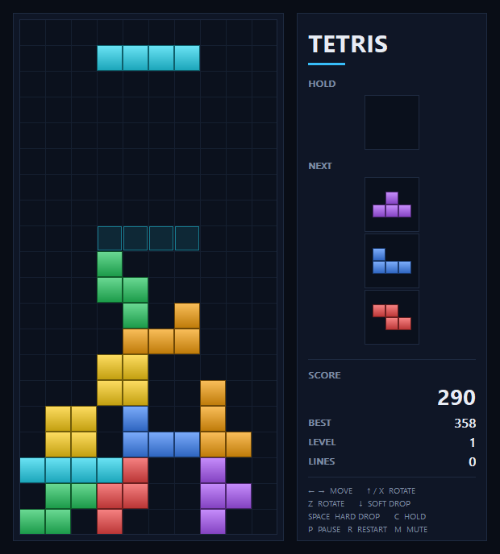

# WinTetris

A small, dependency-free Tetris-like game for Windows, written in C++ with the
Win32 API and GDI. One window, no engine, no assets.



## Features

- Standard 10x20 playfield with all seven tetrominoes
- 7-bag randomizer, SRS rotation with wall kicks
- Ghost piece, hold slot, and a three-piece next queue
- DAS/ARR auto-repeat, soft drop, hard drop, and a 0.5 s lock delay
- Guideline-style scoring: singles/doubles/triples/tetris, combos, level speed-up
- Line-clear flash, pause and game-over overlays
- Looping chiptune arrangement of Korobeiniki ("Tetris Theme A"), synthesized at
  runtime with no audio files
- Best score saved to `%APPDATA%\WinTetris\best.txt`
- Per-monitor DPI aware; automatically scales down to fit smaller screens
- Dark title bar on Windows 10/11

## Build

Requires Windows 10 or newer and MSVC (Visual Studio 2022+ or Build Tools with the
"Desktop development with C++" workload).

Double-click or run:

```bat
build.bat
```

This produces `tetris.exe`. Alternatively use CMake:

```bat
cmake -B build
cmake --build build --config Release
```

Or compile manually from a Developer Command Prompt:

```bat
cl /nologo /EHsc /std:c++17 /O2 /DUNICODE /D_UNICODE audio.cpp game.cpp main.cpp ^
   /link /SUBSYSTEM:WINDOWS /OUT:tetris.exe winmm.lib
```

## Controls

| Key | Action |
| --- | --- |
| Left / Right | Move (hold to auto-repeat) |
| Down | Soft drop |
| Space | Hard drop |
| Up or X | Rotate clockwise |
| Z | Rotate counter-clockwise |
| C | Hold / swap piece |
| P or Esc | Pause / resume |
| R | Restart |
| M | Mute / unmute music |
| Enter | Resume or restart from the overlays |

Music pauses and resumes with the game, and the game pauses automatically when
the window loses focus.

## Project layout

| File | Contents |
| --- | --- |
| `game.h` / `game.cpp` | Pure game logic: board, pieces, SRS kicks, scoring |
| `audio.h` / `audio.cpp` | Korobeiniki chiptune synthesis and `waveOut` playback |
| `main.cpp` | Win32 window, input, GDI rendering, high-score storage |
| `build.bat` | One-step MSVC build |
| `CMakeLists.txt` | CMake build definition |

## Notes

- The music is a synthesized arrangement of Korobeiniki, a traditional Russian
  folk tune in the public domain. No recordings or audio files are bundled; the
  waveform is generated in memory at startup.
- Gameplay sound effects (moves, line clears) are not implemented yet.
- Scores and progress live only in memory until a best score is saved.
- The code intentionally avoids external libraries so it can be built with only
  the Windows SDK.
